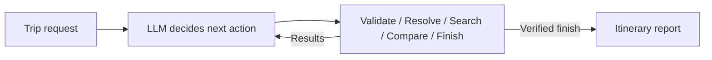

# LangChain trip-planning agent

An LLM-controlled agent that validates a trip request, searches live flights and hotels,
chooses a budget-eligible package, and produces an itinerary report. The model decides
which tool to call next, inspects the results, and can change its search strategy before
selecting a package. LangChain provides model/tool integration; LangGraph runs the loop.



## Run

```bash
python -m venv .venv
source .venv/bin/activate
pip install -e '.[dev]'
```

Set these in a project-root `.env` file (see `.env.example`):

```dotenv
ANTHROPIC_API_KEY=...
SEARCHAPI_API_KEY=...
TRIP_PLANNER_MODEL=claude-haiku-5-5
```

The app loads `.env` automatically. Both natural-language and JSON trip inputs use the
planning LLM and need an Anthropic API key with available API credits. The default model
is Claude Haiku 5.5 (`claude-haiku-5-5`), through LangChain's Anthropic integration.
SearchAPI provides
Google Flights, Google Hotels and flight-location lookup. Optional LangSmith tracing uses
the standard `LANGSMITH_*` environment variables.

```bash
trip-planner "Plan a round trip from San Francisco to Tokyo, leaving April 10, 2027 and returning April 18, 2027. Hotel check-in April 11 and check-out April 18. Two adults, one room, total flights and hotel budget USD 5000. Economy, at most one stop, minimum 3-star hotel, favor comfort."
```

Or provide explicit parameters:

```bash
trip-planner --params examples/tokyo.json
```

JSON parameters are authoritative. They avoid extracting facts from prose, but the LLM
still controls planning. A vague request returns missing details before any travel search:

```bash
trip-planner "plan a trip to japan"
```

Unknown required values remain null. A country does not imply a city. Required fields are
origin, destination city, departure/return flight dates, local hotel check-in/check-out
dates, adults, rooms, total flights-plus-hotel budget and currency. Each run is independent;
complete the request and run it again when details are missing.

## Tools and control flow

The LLM has six tools:

| Tool | Behavior enforced by Python |
| --- | --- |
| `validate_trip` | Validates and freezes the trip facts; missing inputs block searches. |
| `resolve_locations` | Resolves the validated cities/airports through SearchAPI. |
| `search_flights` | Searches round trips; allows price/duration/top-flight sorting and stricter stop limits. |
| `search_hotels` | Searches hotels; allows relevance/price/rating sorting and stricter hotel class. |
| `compare_options` | Computes packages, excludes hard-constraint violations and returns up to 10 verified candidate IDs. |
| `finish_itinerary` | Accepts a verified candidate and the model's explanation, or finishes with missing inputs/errors/no options. |

There is no separate extraction LLM call: the model supplies extracted facts as arguments
to `validate_trip`. It gets the validation result back before choosing its next action.
The only model invocation site is the `decide` node in `src/trip_planner/agent.py`; it runs
once per model turn. Tool selection, additional searches and the final selection are model
decisions. Validation, arithmetic and report formatting use code.

A model cannot invent an offer ID, raise the recorded budget, relax hard preferences or
finalize a package that was not computed from search results. Candidate IDs become invalid
after a new search until the model compares the updated inventory again. The comparison
score is advisory: the model can choose another eligible candidate and explain why.

Defaults are **18 model turns** and **4 distinct flight/hotel searches** per run. Exact
repeat searches are cached within the run. The model may stop sooner. Limits are adjustable:

```bash
trip-planner --params examples/tokyo.json --max-turns 12 --max-searches 3
```

Reaching the model-turn limit returns an error instead of inventing a recommendation.
A search-budget limit still lets the model compare collected offers and finish. Each flight
search uses one outbound request and up to three return-option requests; each hotel search
uses one page. Location resolution uses two API calls. Retries may add requests.

## Report and JSON output

The default output is a Markdown itinerary report with local flight schedules, hotel
dates, free-time overview, cost breakdown, the model's selection explanation, alternatives
and an agent action log. Formatting adds no model call or invented sightseeing activities.

```bash
trip-planner --params examples/tokyo.json > results/my-trip.md
trip-planner --params examples/tokyo.json --format json > results/my-trip.json
```

JSON includes `recommendation`, `alternatives`, `report`, `model_calls` and `agent_trace`.
Both formats include total LLM input/output token usage across every turn, including
repeated conversation context and tool results. JSON `model_usage` preserves each turn's
provider-reported usage, including cached/reasoning token details when available.
`token_usage.complete` is false if any model call lacked usage or failed before returning it;
in that case the reported total is partial. Cached input tokens are included in input totals,
not added twice. Usage measures the planning model, not SearchAPI requests or this coding session.
The trace records tool names, arguments and result statuses, not private model reasoning.
Exit code `0` means success; `2` means missing/invalid inputs, no options or an error.

## Prices and comfort

The budget covers all travelers' round-trip flights plus the complete hotel stay in one
currency. Money uses `Decimal`. SearchAPI return-flight `price` is the complete round-trip
party quote, used once without adding the initial outbound price or multiplying by adults.
Hotel `total_price.extracted_price` is the tax-inclusive full-stay quote; nightly or pre-tax
prices are not substituted. Mixed-cabin flights are excluded.

The advisory package score is:

```text
price_score = 1 - total / budget
comfort_score = 0.30 * (1 - stops / 3)
              + 0.30 * (shortest_matching_duration / flight_duration)
              + 0.40 * (hotel_stars / 5)
score = (1 - comfort_weight) * price_score + comfort_weight * comfort_score
```

`comfort_weight` ranges from 0 (price) to 1 (comfort), default 0.5. Unknown hotel stars use
0.4 for the hotel comfort component and cannot satisfy a minimum-star requirement.
Comfort is a proxy; supplier amenities and room details still need confirmation.

## Scope

Supports one destination, round-trip flights and one room for 1–6 adults. Multi-room
availability, children, one-way/multi-city trips and unsupported hard preferences are
reported as invalid. Ambiguous location names return candidates for correction. Search
coverage is bounded, so recommendations apply to the offers collected during this run.
Prices and availability need rechecking before booking. Meals, transfers and extras not
included by suppliers are outside quoted totals. The agent does not book or take payments.

For development, synthetic travel data can be used with the real planning LLM:

```bash
trip-planner --demo
```

`--demo` requires an Anthropic key and uses API credits; it replaces only the travel provider.
The unit tests run without network access or API credits:

```bash
pytest -q
ruff check src tests
```

## Python API

```python
from dotenv import load_dotenv
from trip_planner import build_agent
from trip_planner.providers import SearchAPIProvider

load_dotenv()
provider = SearchAPIProvider()
try:
    agent = build_agent(provider)
    result = agent.invoke({"request": "plan a trip to japan"})["result"]
    print(result["report"])
finally:
    provider.close()
```

`build_agent` accepts an optional LangChain model, `today`, `max_steps` and `max_searches`.
A fresh session is created per invocation; there is no shared conversation memory.

References: [LangGraph](https://docs.langchain.com/oss/python/langgraph/graph-api),
[LangChain tools](https://docs.langchain.com/oss/python/langchain/tools),
[SearchAPI flights](https://www.searchapi.io/docs/google-flights-api),
[SearchAPI hotels](https://www.searchapi.io/docs/google-hotels-api),
[SearchAPI location lookup](https://www.searchapi.io/docs/google-flights-location-search-api).
